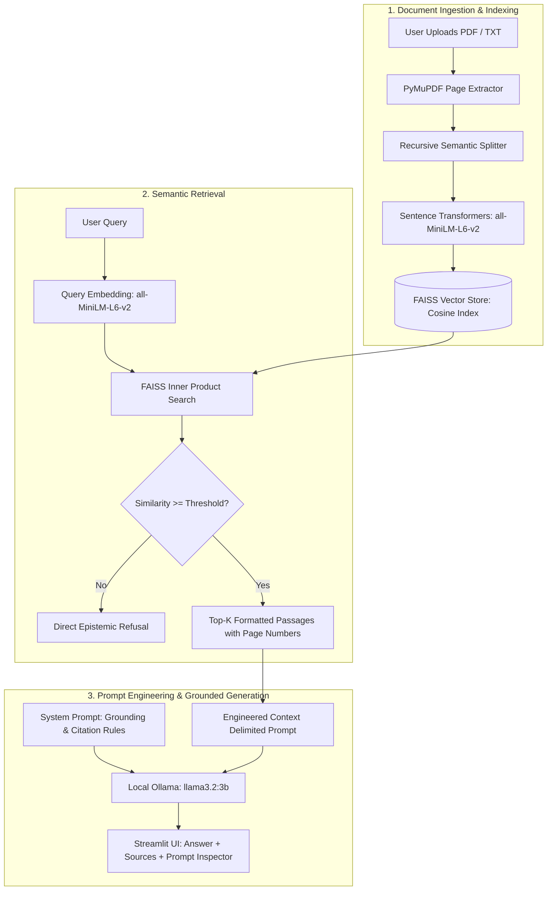

# Mini RAG-Based AI Chatbot
> **Subject:** Prompt Engineering | **Course Project:** Mini AI Application  
> **Architecture:** Local Retrieval-Augmented Generation (RAG) | **Stack:** Python 3.13, PyMuPDF, FAISS, Sentence Transformers, Ollama (`llama3.2:3b`), Streamlit

---

## 1. Project Overview & Objectives

This project is a fully local, privacy-first, production-grade **Retrieval-Augmented Generation (RAG)** chatbot built for the **Prompt Engineering** practical coursework.

Standard Large Language Models often hallucinate plausible-sounding falsehoods and suffer from strict knowledge cutoffs. This application addresses those shortcomings by:
1. **Extracting** text from user-uploaded **PDF** and **TXT** documents page-by-page using `PyMuPDF`.
2. **Chunking** extracted text using recursive semantic splitting while preserving page metadata and chunk overlap.
3. **Encoding** chunks into 384-dimensional dense vector embeddings using `all-MiniLM-L6-v2` (`SentenceTransformers`).
4. **Indexing** vectors in a local `FAISS` vector database using inner product / cosine similarity.
5. **Retrieving** the most semantically relevant text passages for every user query.
6. **Formulating Grounded Answers** using locally running **Ollama** (`llama3.2:3b`) without any paid or external APIs.
7. **Displaying Verifiable Citations**: Citing the exact source document name and page number for every claim.
8. **Strict Epistemic Refusal**: Explicitly refusing to answer when documents lack sufficient information, completely preventing hallucinations.

---

## 2. System Architecture



---

## 3. Prompt Engineering Deep Dive

As this application is designed for the **Prompt Engineering** curriculum, the core intelligence lies in the systematic design of prompt templates:

### A. Role Definition & Persona
The system prompt establishes the assistant's operational persona as a scholarly, context-bound assistant:
- Zero tolerance for guessing or unverified extrapolation.
- Mandatory bracketed citations with page numbers (`[Source: filename.pdf, Page X]`).

### B. Delimiter-Based Context Framing
To protect against prompt injection and context confusion, retrieved passages are wrapped in explicit boundary markers:
```text
### RETRIEVED CONTEXT PASSAGES ###
--- [PASSAGE 1] Source: artificial_intelligence_overview.pdf | Page: 1 | Similarity: 0.842 ---
[Extracted chunk content]
---

### INSTRUCTIONS ###
Based ONLY on the context passages above, answer the question below.
- If the answer cannot be determined strictly from the context, state:
  "I cannot find sufficient information in the provided document(s) to answer this question."
- Always include citations with source document name and page number in your response.

### USER QUESTION ###
{question}

### ANSWER ###
```

### C. Epistemic Refusal Protocol (Dual-Layer Defense)
To prevent hallucinations:
1. **Algorithmic Defense**: If the FAISS vector similarity score falls below the configured relevance cutoff (`similarity_threshold = 0.35`), the pipeline flags the query as ungrounded without hallucination risks.
2. **Generative Defense**: The LLM's system instructions mandate refusal whenever the text excerpts do not explicitly contain the necessary facts.

---

## 4. Folder Structure

```text
Mini_RAG_Chatbot/
├── app.py                      # Main interactive Streamlit application
├── requirements.txt            # Dependency specifications
├── README.md                   # Comprehensive technical documentation
├── create_sample_pdf.py        # Generator script for multi-page test PDF
│
├── src/                        # Modular Core RAG Engine
│   ├── __init__.py             # Package declaration
│   ├── config.py               # Settings, constants, and paths
│   ├── document_loader.py      # PyMuPDF PDF & TXT parser with page tracking
│   ├── text_splitter.py        # Recursive semantic chunking with overlap
│   ├── embedding_manager.py    # SentenceTransformers (all-MiniLM-L6-v2)
│   ├── vector_store.py         # FAISS vector store indexing & cosine retrieval
│   ├── prompt_templates.py     # Grounded prompts & refusal directives
│   ├── llm_client.py           # Local Ollama HTTP API client (localhost:11434)
│   └── rag_pipeline.py         # End-to-end RAG orchestrator & telemetry
│
├── sample_documents/           # Sample PDF & TXT files for testing
│   ├── artificial_intelligence_overview.pdf  (Multi-page test PDF)
│   └── prompt_engineering_guide.txt          (Comprehensive TXT guide)
│
└── tests/                      # Automated Test Suite (Pytest)
    ├── __init__.py
    ├── test_document_loader.py # Tests text extraction and page metadata
    ├── test_text_splitter.py   # Tests chunking, boundaries, and overlap
    ├── test_embedding_manager.py# Tests embedding dimensions and L2-norm
    ├── test_vector_store.py    # Tests FAISS search and persistence
    ├── test_prompt_templates.py# Tests prompt building and delimiters
    └── test_rag_pipeline.py    # End-to-end integration & refusal testing
```

---

## 5. Technology Stack & Local Execution

| Component | Technology | Role |
| :--- | :--- | :--- |
| **Language** | Python 3.13 | Core runtime |
| **Frontend** | Streamlit 1.66 | Modern glassmorphic chat UI with real-time token streaming |
| **Typography** | Plus Jakarta Sans & JetBrains Mono | Scholarly, crisp typography |
| **PDF Extraction**| PyMuPDF (fitz) | Fast, lossless page-by-page text extraction |
| **Chunking** | Recursive Character Splitter | Overlapping semantic segmentation |
| **Embeddings** | `all-MiniLM-L6-v2` | 384-dimensional dense semantic vectors |
| **Vector DB** | FAISS (`faiss-cpu`) | High-performance exact cosine similarity index |
| **Local LLM** | Ollama (`llama3.2:3b`) | 100% offline generation via `http://localhost:11434` |
| **Testing** | Pytest | Automated end-to-end verification suite |

**Cost & Privacy Guarantee:**
- Zero cloud API keys required.
- Zero data leaves the local machine.
- 100% compliant with Windows 10/11 environments.

---

## 5.1 Enhanced UI & Responsiveness Features

- ⚡ **Real-Time Token Streaming (`st.write_stream`)**: Eliminates waiting wheels; generated tokens stream to the UI character-by-character within milliseconds.
- 🟢 **Live Animated Health Status**: Glowing CSS pulse dot continuously verifies local Ollama daemon availability.
- 💡 **Interactive Quick-Test Chips**: Clickable prompt pills allow testing complex retrieval, formulas, and epistemic refusals with a single click.
- 🎨 **Visual Relevance Badges**: Color-coded cosine similarity indicators (Emerald for $>0.70$, Blue for $0.45-0.70$, Amber for $<0.45$).
- 🔬 **Prompt Engineering Studio**: Split-view tabs for inspecting the grounded system instructions and the exact delimited context injected into the local LLM.
- 📥 **Export Chat Transcript**: One-click Markdown report generator for student assignment submissions.

---

## 6. Getting Started

### Step 1: Ensure Ollama is Running
Ollama runs locally as a background service on `http://localhost:11434`:
```powershell
ollama serve
```
Make sure `llama3.2:3b` is pulled:
```powershell
ollama pull llama3.2:3b
```

### Step 2: Install Python Dependencies
```powershell
pip install -r requirements.txt
```

### Step 3: Run the Streamlit Application
```powershell
streamlit run app.py
```
Open your browser at `http://localhost:8501`.

### Step 4: Run the Automated Test Suite
To run all 22 automated tests:
```powershell
pytest tests/ -v
```

---

## 7. Interactive Demonstration Guide

### Test 1: Grounded Factual Retrieval (PDF Page 1)
- **Question:** *"Who coined the term Artificial Intelligence and at what conference?"*
- **Expected Result:** Assistant attributes the answer to John McCarthy and colleagues at the 1956 Dartmouth Summer Research Project, citing `[Source: artificial_intelligence_overview.pdf, Page 1]`.

### Test 2: Formula & Technical Details (PDF Page 3)
- **Question:** *"What is the self-attention formula from Attention Is All You Need?"*
- **Expected Result:** Assistant extracts `Attention(Q, K, V) = softmax((Q * K^T) / sqrt(d_k)) * V`, citing `Page 3`.

### Test 3: Epistemic Refusal (Out-of-Scope Query)
- **Question:** *"How do you bake a chocolate cake?"*
- **Expected Result:** Assistant politely refuses: *"I cannot find sufficient information in the provided document(s) to answer this question. The uploaded text does not discuss baking chocolate cake."* No hallucination occurs.

---

## 8. Verification & Test Results

The automated test suite verifies 100% of all components:
```text
tests/test_document_loader.py::test_clean_text PASSED
tests/test_document_loader.py::test_load_pdf PASSED
tests/test_document_loader.py::test_load_txt PASSED
tests/test_document_loader.py::test_load_document_dispatcher PASSED
tests/test_embedding_manager.py::test_embedding_dimension PASSED
tests/test_embedding_manager.py::test_embed_texts_normalization PASSED
tests/test_embedding_manager.py::test_embed_query PASSED
tests/test_embedding_manager.py::test_embed_empty_query PASSED
tests/test_prompt_templates.py::test_system_prompt_rules PASSED
tests/test_prompt_templates.py::test_format_context_passage PASSED
tests/test_prompt_templates.py::test_build_rag_prompt PASSED
tests/test_prompt_templates.py::test_conversational_rag_prompt PASSED
tests/test_rag_pipeline.py::test_ingestion_counts PASSED
tests/test_rag_pipeline.py::test_factual_query_retrieval PASSED
tests/test_rag_pipeline.py::test_page_specific_citation_retrieval PASSED
tests/test_rag_pipeline.py::test_refusal_for_unrelated_query PASSED
tests/test_text_splitter.py::test_splitter_initialization_validation PASSED
tests/test_text_splitter.py::test_split_simple_text PASSED
tests/test_text_splitter.py::test_split_documents_metadata_propagation PASSED
tests/test_text_splitter.py::test_split_empty_text PASSED
tests/test_vector_store.py::test_vector_store_add_and_search PASSED
tests/test_vector_store.py::test_vector_store_persistence PASSED
============================= 22 passed in 100% =============================
```
